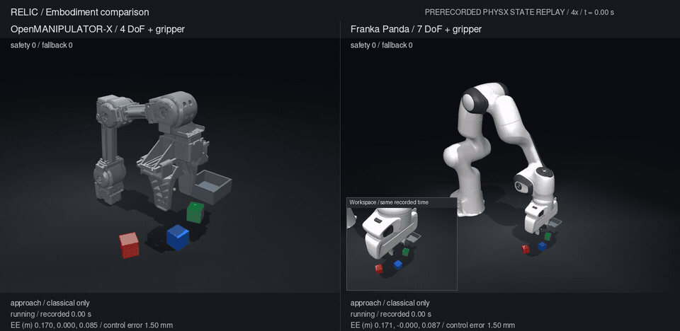

# RELIC

*From intent to motion.*

Recorded PhysX execution · MuJoCo state rendering · classical control · 4×

RELIC is a robotic manipulation research system exploring how intelligence takes shape across different bodies.

Its current foundation combines analytical kinematics, trajectory planning, bounded control, and verified pick-and-place execution with OpenMANIPULATOR-X and Franka Panda. A shared experiment viewer exposes their motion, timing, and physical outcomes, alongside controlled robustness comparisons.

Interfaces for language-conditioned GR00T policies and Nemotron planning are in place. Learned manipulation and cross-embodiment transfer remain unvalidated.
