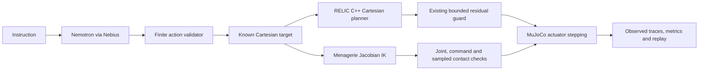

# RELIC interactive Physical AI

Run `bash interactive/setup.sh` once, then `bash interactive/run.sh` and open http://127.0.0.1:8765. The scripts use `RELIC_ML_PYTHON` and `MUJOCO_ROOT`, defaulting to the existing local robotics environment and MuJoCo 3.16.0 SDK. For a fresh environment install `interactive/requirements.txt`; building also requires CMake 3.24 and a C++20 compiler. No training, dataset collection or cloud provisioning occurs.

Choose **Direct target · no AI inference** until a Nebius key arrives. This mode executes genuine simulated actuators but makes no NVIDIA inference claim. Select Menagerie for the realistic arm, or Synthetic for conventional / analytical PI / learned comparisons. The native bridge is built in `build-interactive`; all generated traces, images and recordings live in ignored `interactive/runs`.

For the native graphical viewer:

```sh
$HOME/.local/share/venvs/robotics-ml/bin/python -m interactive.arm --target target_left --degraded --controller integral --output interactive/runs/viewer-left
```

The viewer physically executes one reach and remains open afterward. Close its window to exit. Drag with the mouse to orbit and zoom; interactive GUI perturbations invalidate the fixed comparison conditions. Use a fresh output path for each run. The browser app is the preferred recordable demonstration and also works using EGL without a display server. The native viewer needs a working desktop OpenGL context; the tested Wayland session emitted libdecor/OpenGL startup warnings but completed its measured reach.

## Imported arm

The complete original `low_cost_robot_arm` package comes from [Google DeepMind MuJoCo Menagerie](https://github.com/google-deepmind/mujoco_menagerie/tree/cda5236f98383f6fbaa4820c6b18dba892cd087f/low_cost_robot_arm), pinned to `cda5236f98383f6fbaa4820c6b18dba892cd087f`. All 28 upstream files are preserved byte for byte, including MJCF, 22 STL meshes, README and Apache-2.0 LICENSE. `vendor/manifest.json` records SHA-256 checksums and verified upstream Git blob IDs. Attribution: Alexander Koch, Hugging Face LeRobot team and Google DeepMind MuJoCo Menagerie contributors; upstream derivation and source links remain in its original README.

Four position-controlled hinge joints perform Cartesian reaching: `base_rotation` [-2.2, 2.2], `pitch` [-1.57, 0.6], `elbow` [-1.57, 1.45], and `wrist_pitch` [-2, 2], in radians. Existing `wrist_roll` [-3.14, 3.14] is commanded to 0 and `gripper` [-1.6, 0.032] to -0.65, visibly open. They remain compliant position servos, not welded constraints. Existing actuator names map one-to-one to these joint names; arm force limits are 87/87/87/12 Nm, wrist roll 10 Nm and gripper 5 Nm. All original gains, inertias, collision shapes and exclusions are retained. Controlled degradation is an explicit in-memory gain scale 0.4 and additional 0.15 Nm friction; nominal controller tuning is unchanged.

A wrapper adds one visible tool site near the fixed fingertip and nonphysical target overlays; no upstream XML is edited. Targets are forward-kinematic points from declared safe poses. A bounded damped Jacobian position IK uses only four reaching joints, tries a finite deterministic seed set, holds roll/gripper references and admits a sampled path. It does not control end-effector orientation. Reaching tolerance is 5 mm with final joint speed below 0.02 rad/s after a fixed three-second reference and two-second settlement. This is a reach demonstration, with no object, grasp or transport claim.

The imported arm uses conventional servos and bounded nominal-gravity / velocity-lead / past-error PI compensation. No existing MLP weights are loaded for this embodiment. These manually declared demo PI settings are not evidence of learned adaptation or a tuned general-purpose imported-arm controller.

## NVIDIA task selection

When the key is available, create a private environment file outside the repository containing `NEBIUS_API_KEY=...`. Never paste it into an instruction or commit it. Launch:

```sh
bash interactive/run.sh --env-file /home/iris/.config/relic/nebius.env
```

The client also supports `NEBIUS_TOKEN_FACTORY_API_KEY`, `NEBIUS_BASE_URL` and `NEBIUS_MODEL`, or `--base-url` / `--model` CLI flags. Defaults are `https://api.tokenfactory.nebius.com/v1/` and `nvidia/Nemotron-3_5-Lightning`. It discovers the authenticated `/models` catalog before each explicitly requested completion and requires the chosen NVIDIA model to exist. It sends one bounded JSON-schema completion; no retries, paid provisioning or background inference occurs. The default timeout is 25 seconds per HTTP request (catalog and completion separately).

```sh
$HOME/.local/share/venvs/robotics-ml/bin/python -m interactive.actions --env-file /home/iris/.config/relic/nebius.env --models
MUJOCO_GL=egl $HOME/.local/share/venvs/robotics-ml/bin/python -m interactive.demo --robot menagerie --instruction 'Reach the blue target on the left.' --env-file /home/iris/.config/relic/nebius.env --degraded --output interactive/runs/live-left
MUJOCO_GL=egl $HOME/.local/share/venvs/robotics-ml/bin/python -m interactive.demo --robot synthetic --instruction 'Reach the mint target on the right.' --env-file /home/iris/.config/relic/nebius.env --degraded --output interactive/runs/live-right
```

Only `{"action":"reach_target","target_id":"target_left"}` and equivalent known center/right IDs can execute. Extra fields, duplicate JSON keys, malformed responses, unknown IDs, unsupported actions and incomplete responses are rejected. A model can decline an unsupported instruction using `reject_task`; this also prevents execution. The model selects a scene label, not joint angles, control gains, trajectories or arbitrary world coordinates. Semantic instruction interpretation remains the model's responsibility; deterministic validation guarantees the finite action boundary, not perfect language understanding.

Selection logs contain live/mock/manual identity, model, request ID, hashed and redacted input, validated output, latency, token counts and rejection reason. Credentials and raw model prose are not logged. Localhost API endpoints are permitted for tests and explicitly labeled mock; redirects are refused. The UI binds only to 127.0.0.1 and requires same-origin execution requests. This local research service is not an authenticated multiuser deployment.

Live acceptance is **pending**: Nebius has not delivered the user's key. Local fake-API tests are not a successful NVIDIA demonstration. Once available, run both instructions above and inspect selection logs plus measured comparison files before recording the final video.

## Motion integration and safety



`bridge.cpp` calls existing `plan_cartesian_motion` and reuses `Simulation`, `TraceWriter`, native MLP loading/features, `guarded`, `safe_segment` and observed health/contact checks. It adds an opt-in execution loop for arbitrary validated scene targets. It does not change `execute_cartesian_motion`, production defaults, synthetic model generation or the historical adaptive executor. It addresses the planner/research-executor separation with this small demo adapter rather than claiming the learned model is the default production Cartesian controller.

The synthetic bridge follows the production planner's linear joint references, with constant velocity and zero acceleration features away from discontinuous endpoints. The frozen learned model was trained on quintic research references; this distribution difference is explicit and no retraining is performed. Conventional, PI and learned methods receive the identical plan, initial state, physical parameters, fixed two-second settlement, correction/command bounds and health rules. The original production executor has its own dwell, timeout and reporting semantics; this comparison loop does not claim identical timing or success criteria to that executor.

For the imported arm, `arm.py` owns separate MuJoCo execution, planning and nominal-gravity data. It uses its actual MJCF kinematics, not synthetic analytical IK. Both imported controllers share a 0.005 rad command-step bound, ±0.12 rad correction magnitude and 0.0005 rad correction-rate bound per 0.002 s tick, joint/control/effort limits, finite-state/warning monitoring, observed speed bound and contact checks. It checks commanded and observed connecting paths at no more than 0.01 rad spacing. The native bridge reuses calibrated synthetic per-joint bounds and 0.002 rad path sampling from the existing adaptive guard. These are discrete checks, not continuous collision guarantees.

Invalid corrections latch rate-limited withdrawal through validated intermediate commands. Infeasible withdrawal or unsafe observed motion terminates stepping and records a reason; unsafe finite observations are retained separately. A safe fallback can still fail task accuracy. Native controller failures are not replaced by successful scripted motion. `TraceWriter` supplies native conventional telemetry; JSON traces additionally retain desired reference, observed state, command, correction, effort, phase, contacts and fallback reason. Imported traces are explicitly separate six-joint records. Viewer images are sampled actual observations, without interpolation; rendering writes qpos only into separate visualization data, never to drive an execution.

## Tests, measurements and recording

```sh
ctest --test-dir build-interactive --output-on-failure -j4
MUJOCO_GL=egl $HOME/.local/share/venvs/robotics-ml/bin/python -m interactive.qualify
MUJOCO_GL=egl $HOME/.local/share/venvs/robotics-ml/bin/python -m interactive.demo --robot synthetic --target target_left --degraded --output interactive/runs/offline-synthetic
$HOME/.local/share/venvs/robotics-ml/bin/python -m interactive.capture interactive/runs/offline-synthetic/execution --output interactive/runs/offline-synthetic.mp4
```

The build registers the original 35 tests plus one integration suite containing eight test methods. New checks cover asset checksums, mappings/limits/IK, sampled contact rejection, data isolation, deterministic closed-loop repeats, nonzero-correction withdrawal, missing weights, paired conditions, strict action parsing, authentication/timeouts/malformed API data and mocked selection through actual native physics. The tests use only local mock HTTP calls. See `results/validation.json`, `results/arm_qualification.json` and `results/synthetic_qualification.json` for measured results; historical adaptive validation remains unchanged.

Capture exports H.264 MP4 from the sampled recorded observations, labeled with controller, outcome and measured errors. It requires a locally installed FFmpeg and does not overwrite existing videos. The original per-timestep trace remains authoritative; the video is a sampled replay, not an independent execution. The UI also allows selecting each comparator, scrubbing and playing the same recorded observations. For a three-minute submission: show a live NVIDIA left/right task selection and validation, at least one minute of actual application modules (selection, execution, controller feedback and replay), one reported failure, and the scope/limitations. Reserve October 30 for final verification and submission.

## Dependency and license audit

Imported assets: Apache-2.0, original license included. Runtime: MuJoCo Apache-2.0, NumPy BSD-3-Clause, Pillow HPND; the optional MuJoCo viewer additionally uses GLFW (zlib) and PyOpenGL (BSD-style). The HTTP client/server use the Python standard library; no OpenAI SDK or downloaded pretrained model is required. FFmpeg is an optional separately installed capture tool; the local H.264 encoder is GPL-enabled, and no FFmpeg binary is distributed. No Isaac Lab, GR00T, Cosmos or additional dataset campaign is introduced.

The repository currently has no top-level project license file. Its owner's choice of a project license remains necessary before claiming the whole RELIC repository is licensed for public redistribution. This integration does not invent a license for existing user code. Consult the upstream LICENSE files and installed distribution metadata for complete dependency terms.
